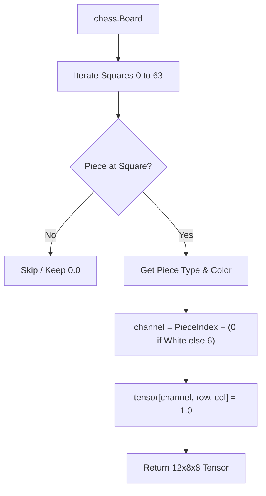
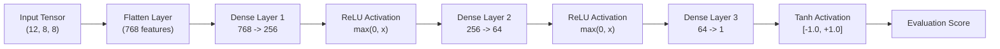
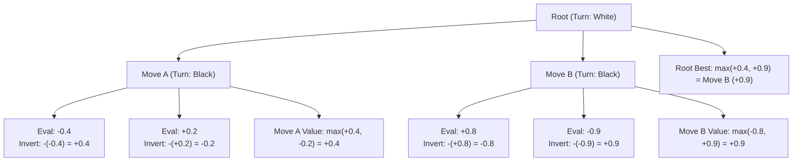

# Comprehensive Foundations: Concepts, Mathematics & Architecture

Welcome to the foundational master guide for **Chess-Made-Intelligent**. This document explains every single concept, algorithm, formula, and library used in this project from absolute ground zero ($0$) to advanced implementation.

---

## Table of Contents
1. [The Nature of Chess as a Computational Problem](#1-the-nature-of-chess-as-a-computational-problem)
2. [Chess Board Representation (Bitboards vs Tensors)](#2-chess-board-representation-bitboards-vs-tensors)
3. [The $12 \times 8 \times 8$ Neural Input Tensor](#3-the-12-times-8-times-8-neural-input-tensor)
4. [Neural Network Architecture & Forward Propagation](#4-neural-network-architecture--forward-propagation)
5. [Loss Functions & Training Dynamics](#5-loss-functions--training-dynamics)
6. [Game Tree Search: Minimax & Negamax](#6-game-tree-search-minimax--negamax)
7. [Alpha-Beta Pruning (Mathematical Formulation & Proof)](#7-alpha-beta-pruning-mathematical-formulation--proof)
8. [Move Ordering & Heuristics (MVV-LVA)](#8-move-ordering--heuristics-mvv-lva)
9. [The Horizon Effect & Quiescence Search](#9-the-horizon-effect--quiescence-search)
10. [Under the Hood: Deep Dive into the Libraries](#10-under-the-hood-deep-dive-into-the-libraries)

---

## 1. The Nature of Chess as a Computational Problem

Chess is a **two-player, zero-sum, perfect information, deterministic game**:
- **Two-Player**: Moves alternate sequentially between White and Black.
- **Zero-Sum**: Any gain for White is an identical loss for Black ($U_{\text{White}} + U_{\text{Black}} = 0$).
- **Perfect Information**: Both players can observe the entire state of the board simultaneously. There are no hidden cards or fog of war.
- **Deterministic**: No randomness or dice rolls. An identical move from an identical position always produces the exact same resulting board state.

### The Combinatorial Explosion (Shannon Number)
In an average chess position, a player has approximately $b \approx 35$ legal moves (the **branching factor**). A typical game lasts around $40$ moves per player ($d = 80$ plies/half-moves).

The total number of possible games is:
$$\text{Game Tree Complexity} \approx b^d \approx 35^{80} \approx 10^{123}$$

For comparison, there are only about $10^{80}$ atoms in the observable universe. This means **brute-force search to the end of the game is physically impossible**.

To play intelligently, an AI must do two things:
1. **Prune the search tree** to inspect only the most promising moves (Alpha-Beta Search).
2. **Evaluate static positions** accurately when it cannot search any deeper (Evaluation Function / Neural Network).

---

## 2. Chess Board Representation (Bitboards vs Tensors)

### Coordinate System
An 8x8 chessboard has 64 squares, numbered $0$ to $63$:
- File $a \to h$ corresponds to columns $0 \to 7$.
- Rank $1 \to 8$ corresponds to rows $0 \to 7$.

$$\text{Square Index } s = 8 \times \text{rank} + \text{file}$$

$$\text{rank} = \lfloor s / 8 \rfloor, \quad \text{file} = s \pmod 8$$

```
Rank 8 | 56 57 58 59 60 61 62 63
Rank 7 | 48 49 50 51 52 53 54 55
Rank 6 | 40 41 42 43 44 45 46 47
Rank 5 | 32 33 34 35 36 37 38 39
Rank 4 | 24 25 26 27 28 29 30 31
Rank 3 | 16 17 18 19 20 21 22 23
Rank 2 |  8  9 10 11 12 13 14 15
Rank 1 |  0  1  2  3  4  5  6  7
       --------------------------
         a  b  c  d  e  f  g  h
```

### Bitboards (`python-chess` internal representation)
Modern chess engines use **Bitboards**: a 64-bit unsigned integer (`uint64`) where each bit corresponds to one square on the board:
$$\text{Bitboard} = \sum_{s=0}^{63} b_s \cdot 2^s, \quad b_s \in \{0, 1\}$$
Bitwise operations (`AND`, `OR`, `XOR`, shifts) allow calculating pawn pushes, attacks, and pins across all 64 squares in a single CPU instruction cycle.

However, Bitboards are compact binary representations for CPUs. Deep learning models require structured, multi-dimensional floating-point tensors.

---

## 3. The $12 \times 8 \times 8$ Neural Input Tensor

### Why not pass numbers $1$ to $6$ for pieces into a single $8 \times 8$ matrix?
If we encoded a Pawn as $1$, a Knight as $2$, a Bishop as $3$, a Rook as $4$, a Queen as $5$, and a King as $6$, a neural network would implicitly assume numerical order and magnitude:
$$\text{Bishop (3)} + \text{Knight (2)} = \text{Queen (5)} \quad \text{(Mathematically False!)}$$
Categorical variables in machine learning must be **one-hot encoded**.

### Spatial Channel Encoding
In chess, there are $6$ unique piece types:
- Pawn ($P$), Knight ($N$), Bishop ($B$), Rook ($R$), Queen ($Q$), King ($K$)
And $2$ colors: White and Black.
$$6 \times 2 = 12 \text{ channels}$$

We construct a 3-dimensional tensor $\mathbf{X} \in \mathbb{R}^{12 \times 8 \times 8}$:

| Channel Index | Color | Piece Type | Meaning |
| :---: | :---: | :---: | :--- |
| **0** | White | Pawn | $1.0$ where White pawns are placed, else $0.0$ |
| **1** | White | Knight | $1.0$ where White knights are placed, else $0.0$ |
| **2** | White | Bishop | $1.0$ where White bishops are placed, else $0.0$ |
| **3** | White | Rook | $1.0$ where White rooks are placed, else $0.0$ |
| **4** | White | Queen | $1.0$ where White queens are placed, else $0.0$ |
| **5** | White | King | $1.0$ where White king is placed, else $0.0$ |
| **6** | Black | Pawn | $1.0$ where Black pawns are placed, else $0.0$ |
| **7** | Black | Knight | $1.0$ where Black knights are placed, else $0.0$ |
| **8** | Black | Bishop | $1.0$ where Black bishops are placed, else $0.0$ |
| **9** | Black | Rook | $1.0$ where Black rooks are placed, else $0.0$ |
| **10** | Black | Queen | $1.0$ where Black queens are placed, else $0.0$ |
| **11** | Black | King | $1.0$ where Black king is placed, else $0.0$ |

### Mathematical Tensor Assignment Formula
For any square $s \in \{0, \dots, 63\}$:
$$\text{piece} = \text{board.piece\_at}(s)$$
$$\text{If piece is None} \implies \text{Do nothing (remains } 0.0\text{)}$$
$$\text{If piece is Present}:$$
$$\text{row} = \lfloor s / 8 \rfloor, \quad \text{col} = s \pmod 8$$
$$\text{channel\_offset} = \begin{cases} 0 & \text{if color is White} \\ 6 & \text{if color is Black} \end{cases}$$
$$\text{channel} = \text{PieceIndices}[\text{piece\_type}] + \text{channel\_offset}$$
$$\mathbf{X}[\text{channel}, \text{row}, \text{col}] = 1.0$$



---

## 4. Neural Network Architecture & Forward Propagation

`ChessNet` is a deep Multi-Layer Perceptron (MLP) mapping board states to a scalar evaluation:
$$f_\theta: \mathbb{R}^{12 \times 8 \times 8} \to [-1.0, +1.0]$$



### Layer Breakdown & Dimensions
1. **Flatten Layer**:
   $$12 \times 8 \times 8 = 768 \text{ input neurons}$$
2. **Hidden Layer 1**:
   $$\mathbf{z}^{(1)} = \mathbf{W}^{(1)} \mathbf{x} + \mathbf{b}^{(1)}, \quad \mathbf{W}^{(1)} \in \mathbb{R}^{256 \times 768}, \quad \mathbf{b}^{(1)} \in \mathbb{R}^{256}$$
   $$\text{Parameters} = (768 \times 256) + 256 = 196,864$$
3. **Activation 1 (ReLU)**:
   $$\text{ReLU}(z) = \max(0, z)$$
   *Why ReLU?* Eliminates the vanishing gradient problem in intermediate layers, allows fast computation, and encourages sparse, distinct feature activations.
4. **Hidden Layer 2**:
   $$\mathbf{z}^{(2)} = \mathbf{W}^{(2)} \mathbf{a}^{(1)} + \mathbf{b}^{(2)}, \quad \mathbf{W}^{(2)} \in \mathbb{R}^{64 \times 256}, \quad \mathbf{b}^{(2)} \in \mathbb{R}^{64}$$
   $$\text{Parameters} = (256 \times 64) + 64 = 16,448$$
5. **Activation 2 (ReLU)**:
   $$\mathbf{a}^{(2)} = \text{ReLU}(\mathbf{z}^{(2)})$$
6. **Output Layer**:
   $$z^{(3)} = \mathbf{W}^{(3)} \mathbf{a}^{(2)} + b^{(3)}, \quad \mathbf{W}^{(3)} \in \mathbb{R}^{1 \times 64}, \quad b^{(3)} \in \mathbb{R}^1$$
   $$\text{Parameters} = (64 \times 1) + 1 = 65$$
7. **Output Activation (Hyperbolic Tangent $\tanh$)**:
   $$\hat{y} = \tanh(z^{(3)}) = \frac{e^{z^{(3)}} - e^{-z^{(3)}}}{e^{z^{(3)}} + e^{-z^{(3)}}}$$
   *Why $\tanh$?* The evaluation of a zero-sum game is symmetric:
   - $+1.0 \implies$ White is completely winning (e.g. checkmate or overwhelming material).
   - $0.0 \implies$ Perfectly balanced / dead drawn position.
   - $-1.0 \implies$ Black is completely winning.

---

## 5. Loss Functions & Training Dynamics

### Mean Squared Error (MSE) Loss
Given a training dataset of $N$ board positions with target evaluations $y_i \in [-1.0, +1.0]$:
$$\mathcal{L}(\theta) = \frac{1}{N} \sum_{i=1}^N \left( \hat{y}_i(\theta) - y_i \right)^2$$

### Gradient Descent & Backpropagation
To update network parameters $\theta = \{ \mathbf{W}^{(l)}, \mathbf{b}^{(l)} \}$:
$$\theta \leftarrow \theta - \eta \cdot \frac{\partial \mathcal{L}}{\partial \theta}$$
Where $\eta$ is the **learning rate** (e.g., $10^{-3}$).

### The Adam Optimizer
Instead of standard Stochastic Gradient Descent (SGD), we use **Adam** (Adaptive Moment Estimation), which computes individual adaptive learning rates for different parameters using estimates of first and second moments of the gradients:
$$m_t = \beta_1 m_{t-1} + (1 - \beta_1) g_t \quad (\text{momentum})$$
$$v_t = \beta_2 v_{t-1} + (1 - \beta_2) g_t^2 \quad (\text{RMSProp variance})$$
$$\hat{m}_t = \frac{m_t}{1 - \beta_1^t}, \quad \hat{v}_t = \frac{v_t}{1 - \beta_2^t}$$
$$\theta_t = \theta_{t-1} - \frac{\eta}{\sqrt{\hat{v}_t} + \epsilon} \hat{m}_t$$

---

## 6. Game Tree Search: Minimax & Negamax

### The Minimax Principle
In a two-player zero-sum game, White is the **Maximizer** (wants to maximize the evaluation score) and Black is the **Minimizer** (wants to minimize the evaluation score).

At each turn:
$$\text{Minimax}(s, d) = \begin{cases}
\text{Eval}(s) & \text{if } d = 0 \text{ or terminal}(s) \\
\max_{m \in \text{Moves}(s)} \text{Minimax}(\text{Result}(s, m), d-1) & \text{if White's turn} \\
\min_{m \in \text{Moves}(s)} \text{Minimax}(\text{Result}(s, m), d-1) & \text{if Black's turn}
\end{cases}$$

### The Negamax Simplification
Minimax requires two separate functions or conditional branching for White and Black. **Negamax** simplifies this by exploiting the mathematical identity:
$$\max(a, b) = -\min(-a, -b)$$

By always calculating scores **from the perspective of the player whose turn it is to move**, a single recursive function handles both players:

$$\text{Negamax}(s, d) = \begin{cases}
\text{Eval}(s) \times \text{color} & \text{if } d = 0 \text{ or terminal}(s) \\
\max_{m \in \text{Moves}(s)} \left( - \text{Negamax}(\text{Result}(s, m), d-1) \right) & \text{otherwise}
\end{cases}$$

Where $\text{color} = +1$ for White and $-1$ for Black.



---

## 7. Alpha-Beta Pruning (Mathematical Formulation & Proof)

### The Core Idea
Minimax visits every single node in the tree ($O(b^d)$). But if a player discovers a move that guarantees a score $X$, and while exploring an alternative move, the opponent has a response that forces a score worse than $X$, the player will **never choose this alternative move**. Exploring that branch further is completely wasted computation.

### Parameters $\alpha$ and $\beta$
- **$\alpha$ (Alpha)**: The minimum score the maximizing player is guaranteed to achieve. (Initial value: $-\infty$).
- **$\beta$ (Beta)**: The maximum score the minimizing opponent will allow. (Initial value: $+\infty$).

The valid search window is $[\alpha, \beta]$.

### The Pruning Condition
When exploring a child move, we obtain an evaluation score $v$.
1. If $v > \alpha$, we update $\alpha = v$ (we found a better guaranteed move).
2. If $\alpha \ge \beta$, we immediately stop exploring sibling moves:
$$\mathbf{\alpha \ge \beta \implies \text{BETA CUTOFF (PRUNE)}}$$

```
           [Node A: alpha=3, beta=5]
                 /            \
           [Branch 1]      [Branch 2]
             eval=3         opponent has move leading to eval=2
                             Since 2 <= alpha(3), Node A will never take Branch 2!
                             --> PRUNE all other children of Branch 2!
```

### Search Efficiency Comparison
| Search Strategy | Nodes Visited at Depth 4 ($b=35$) | Time on Modern CPU |
| :--- | :--- | :--- |
| **Pure Minimax** | $35^4 = 1,500,625$ nodes | $\approx 12 - 15 \text{ seconds}$ |
| **Alpha-Beta (Worst Order)** | $35^4 = 1,500,625$ nodes | $\approx 12 - 15 \text{ seconds}$ |
| **Alpha-Beta (Optimal Order)** | $2 \times 35^2 = 2,450$ nodes | $\approx 0.05 \text{ seconds}$ |

**Conclusion**: Optimal Alpha-Beta cuts the effective branching factor from $b$ to $\sqrt{b}$, effectively doubling the search depth for the same compute budget!

---

## 8. Move Ordering & Heuristics (MVV-LVA)

Alpha-Beta pruning's efficiency depends entirely on **which moves are checked first**. If the best move is checked first, $\beta$-cutoffs occur immediately on the very first child!

### Most Valuable Victim - Least Valuable Attacker (MVV-LVA)
Capturing an opponent's high-value piece with your low-value piece is almost always the strongest tactical move.
$$\text{Priority} = 10 \times \text{Value}(\text{Victim}) - \text{Value}(\text{Attacker})$$

| Move Example | Victim Value | Attacker Value | Score |
| :--- | :---: | :---: | :---: |
| **Pawn takes Queen ($P \times Q$)** | $9.0$ | $1.0$ | $10 \times 9 - 1 = \mathbf{89}$ |
| **Rook takes Queen ($R \times Q$)** | $9.0$ | $5.0$ | $10 \times 9 - 5 = \mathbf{85}$ |
| **Pawn takes Pawn ($P \times P$)** | $1.0$ | $1.0$ | $10 \times 1 - 1 = \mathbf{9}$ |
| **Queen takes Pawn ($Q \times P$)** | $1.0$ | $9.0$ | $10 \times 1 - 9 = \mathbf{1}$ |

In our engine:
1. **Captures** are evaluated first, sorted by MVV-LVA.
2. **Checks** (moves that give check to the enemy king) are evaluated next.
3. **Quiet moves** (positional maneuvers) are evaluated last.

---

## 9. The Horizon Effect & Quiescence Search

### The Problem
Suppose the engine searches to Depth 3. At Depth 3, the engine plays $Q \times P$ (Queen takes Pawn). Because the search horizon ends at Depth 3, the engine doesn't see that on move Depth 4, the opponent's pawn will capture its Queen! The engine mistakenly thinks it just won a free pawn. This blindness just beyond the search horizon is called the **Horizon Effect**.

### The Solution: Quiescence Search
When regular search reaches depth 0, we do not immediately return static evaluation if the position is "turbulent" (i.e. captures are available). Instead, we continue searching **only capture moves** until a "quiet" position is reached where no pieces are hanging.

---

## 10. Under the Hood: Deep Dive into the Libraries

### 10.1 `python-chess`
`python-chess` is the premier Python chess library. Here is what it does for us:
1. **Move Generation**: `board.legal_moves` dynamically generates legal moves while enforcing pin constraints and check evasions.
2. **Board State Transitions**: `board.push(move)` applies a move, updates castling flags, en passant squares, half-move clocks, and bitboards. `board.pop()` cleanly reverts to the previous position without copying memory.
3. **Check & Terminal Checks**:
   - `board.is_check()`: Tests if current king is attacked.
   - `board.is_checkmate()`: Tests if in check and no legal moves exist.
   - `board.is_stalemate()`: Tests if not in check and no legal moves exist.
   - `board.is_insufficient_material()`: Tests for $K \text{ vs } K$, $K+N \text{ vs } K$, etc.
   - `board.can_claim_threefold_repetition()`: Checks 3-position recurrence.
4. **Coordinate and Square Conversion**: `chess.SQUARES`, `chess.square_name(s)`, `chess.parse_san(san)`.

### 10.2 `PyTorch` (`torch` & `torch.nn`)
PyTorch provides tensor computation with hardware acceleration and automatic differentiation:
1. **Tensors (`torch.Tensor`)**: Multi-dimensional arrays with explicit data types (`torch.float32`).
2. **Computational Graph (`autograd`)**: Automatically tracks operations during the forward pass to calculate partial derivatives $\frac{\partial \mathcal{L}}{\partial w}$ during `loss.backward()`.
3. **`nn.Module`**: The base class for all neural network modules. Encapsulates trainable parameters, buffers, and submodules (`nn.Linear`, `nn.ReLU`, `nn.Tanh`).
4. **`model.eval()` and `torch.no_grad()`**: Disables gradient computation graph during engine search, boosting inference speed and saving RAM.

### 10.3 Python `tkinter`
`tkinter` is Python's standard graphical interface toolkit (wrapper around Tcl/Tk):
1. **`Canvas`**: Provides vector drawing methods (`create_rectangle`, `create_text`, `create_oval`) for smooth board and piece rendering.
2. **Event Binding**: `canvas.bind("<Button-1>", callback)` captures mouse clicks and converts pixel coordinates $(x, y)$ to chess squares $(row, col)$.
3. **Multi-Threading (`threading.Thread`)**: Prevents the UI from freezing. Chess search algorithms block execution for hundreds of milliseconds. By running the search in a separate background thread, the GUI event loop continues processing window repaints and button clicks seamlessly.
