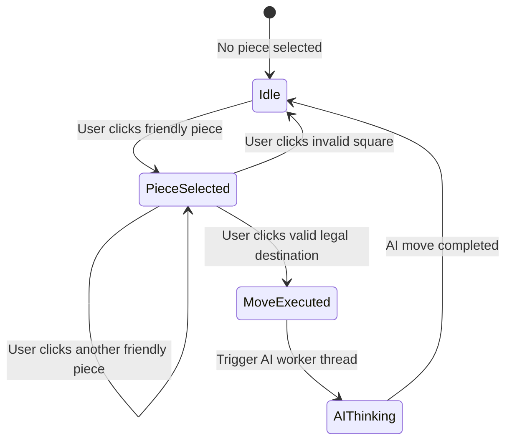

# Code Walkthrough & Line-by-Line Explanation: `gui.py`

This document provides an exhaustive, line-by-line breakdown of `gui.py`. It explains the architecture of the user interface, coordinate transformation mathematics, graphical rendering techniques, and the threading model that ensures a fluid 60fps experience.

---

## 1. High-Level Architecture of `gui.py`

`gui.py` provides the visual and interactive bridge between the human player and the chess engine. Its primary responsibilities are:
1. **Interactive Chessboard Rendering**: Drawing an $8 \times 8$ grid with dynamic color highlights for selected pieces, legal moves, previous moves, and King check alerts.
2. **Coordinate Translation**: Translating pixel $(x, y)$ screen coordinates into 0–63 chess square indices (and vice versa), taking board orientation into account.
3. **Move Validation & Execution**: Interfacing with `chess.Board` to preview legal destinations, validate human moves, and handle special cases (e.g. pawn promotion).
4. **Asynchronous Engine Dispatching**: Running the CPU-intensive Alpha-Beta search on a dedicated background thread so the user interface never freezes or stutters.
5. **Move History & Status Reporting**: Maintaining a formatted algebraic move notation list (SAN) and updating game-state banners.

---

## 2. Detailed Component Breakdown

### 2.1 Unicode Glyphs & Styling Constants (Lines 11–49)
```python
UNICODE_PIECES = {
    chess.Piece(chess.PAWN, chess.WHITE): "♙",
    chess.Piece(chess.KNIGHT, chess.WHITE): "♘",
    ...
    chess.Piece(chess.KING, chess.BLACK): "♚",
}
```
- Maps each `chess.Piece(type, color)` to a distinct high-resolution Unicode chess character.
- Unicode avoids the need for external PNG/SVG image assets, ensuring instant cross-platform portability with zero asset loading latency.

```python
COLOR_LIGHT_SQUARE = "#F0D9B5"     # Warm cream
COLOR_DARK_SQUARE = "#B58863"      # Rich hazelnut walnut
COLOR_SELECTED = "#F6D04D"         # Amber highlight
COLOR_LAST_MOVE = "#D4E157"        # Pale olive yellow
COLOR_CHECK = "#EF5350"            # Soft crimson warning
COLOR_HINT_DOT = "#558B2F"         # Olive green dot for empty targets
COLOR_HINT_CAPTURE = "#E53935"     # Scarlet ring for captures
```
- Carefully curated color tokens based on modern digital chess standards (e.g. Lichess / Chess.com wood palette).

---

### 2.2 Board Sizing & Layout: `ChessGUI.__init__` & `_init_ui` (Lines 52–186)
```python
self.square_size = 72
self.board_size = self.square_size * 8  # 576 x 576 pixels
```
- Defines a large, crisp $576 \times 576$ pixel canvas.
- The window is partitioned into two flex areas:
  - **Left Container**: Holds the interactive Tkinter `Canvas`.
  - **Right Sidebar**: Houses status badges, search depth dropdown, move ledger, and action buttons.

```python
self.canvas.bind("<Button-1>", self._on_canvas_click)
```
- Binds standard left-mouse button clicks on the canvas to the event handler `_on_canvas_click`.

---

### 2.3 Coordinate Transformation Mathematics (Lines 188–226)

#### From Chess Square Index to Canvas Pixels: `_square_to_coords`
A square index $s \in [0, 63]$ has:
$$\text{file} = s \pmod 8, \quad \text{rank} = \lfloor s / 8 \rfloor$$

If the board is viewed as **White**:
- Column on canvas: $\text{col} = \text{file}$
- Row on canvas: $\text{row} = 7 - \text{rank}$ (Rank 8 is at top row 0; Rank 1 is at bottom row 7)

If the board is viewed as **Black** (flipped):
- $\text{col} = 7 - \text{file}$
- $\text{row} = \text{rank}$

Pixel bounding box:
$$x_1 = \text{col} \times \text{square\_size}, \quad y_1 = \text{row} \times \text{square\_size}$$
$$x_2 = x_1 + \text{square\_size}, \quad y_2 = y_1 + \text{square\_size}$$

#### From Canvas Pixel Click to Chess Square: `_coords_to_square`
Given a mouse click at $(x, y)$:
$$\text{col} = \lfloor x / \text{square\_size} \rfloor, \quad \text{row} = \lfloor y / \text{square\_size} \rfloor$$
Convert back to file and rank based on player orientation:
$$\text{square} = 8 \times \text{rank} + \text{file}$$

---

### 2.4 Graphical Rendering Pipeline: `_draw_board` (Lines 228–315)
The canvas uses an atomic layer redraw strategy:
```python
self.canvas.delete("all")
```

1. **Layer 1: 64 Squares & Highlights**:
   - Computes square parity: `is_light = (file + rank) % 2 != 0`.
   - Overrides background with `COLOR_SELECTED` if the square is clicked.
   - Overrides with `COLOR_LAST_MOVE` for previous move origin/destination.
   - Overrides with `COLOR_CHECK` if the King is currently under attack.

2. **Layer 2: Rank and File Border Labels**:
   - Draws small coordinate identifiers ($a \dots h, 1 \dots 8$) on the edge of the board.

3. **Layer 3: Legal Move Target Hints**:
   - If the target square is empty: draws a subtle circular dot of radius $r = 10\text{px}$ in the square center.
   - If the target square contains an enemy piece: draws a bold circular boundary ring ($r = 32\text{px}$, width $= 4\text{px}$) indicating a valid capture.

4. **Layer 4: Pieces with Drop Shadows**:
   - To ensure pieces stand out vividly against both light and dark squares, each piece is drawn twice:
     1. Once in dark shadow (`#1A1A1A`) shifted by $+1\text{px}, +2\text{px}$.
     2. Once in crisp primary color (`#FFFFFF` for White, `#1E1E1E` for Black).

---

### 2.5 Human Move Handling: `_on_canvas_click` (Lines 317–365)
The user interaction follows a two-click finite state machine:


- **Pawn Promotion Detection**:
  ```python
  if selected_piece.piece_type == chess.PAWN:
      if (selected_piece.color == chess.WHITE and target_rank == 7) or ...:
          move.promotion = chess.QUEEN
  ```
  Automatically promotes reaching pawns to a Queen.

---

### 2.6 Multi-Threaded Engine Execution (Lines 391–428)

#### The Problem with Single-Threaded GUIs
Tkinter's `root.mainloop()` is a single-threaded event loop. If the search engine computes for $1.5$ seconds on the main thread, the OS treats the window as frozen, leading to:
- No visual updates (status labels don't show "AI is calculating...").
- Mouse clicks queue up or trigger Windows "Not Responding" alerts.

#### The Multi-Threaded Solution
```python
def _start_ai_turn(self):
    self.is_ai_thinking = True
    self.status_var.set("AI is calculating...")
    self.status_label.configure(bg="#D97706")
    
    # Spawn non-blocking worker thread
    thread = threading.Thread(target=self._run_ai_search, daemon=True)
    thread.start()
```
- `daemon=True` ensures the thread terminates immediately if the user closes the window.

```python
def _run_ai_search(self):
    depth = self.depth_var.get()
    best_move, score = self.engine.get_best_move(self.board, depth=depth)
    
    # Safely schedule GUI update on Tkinter's main thread
    self.root.after(0, self._finish_ai_turn, best_move, score)
```
- **Thread Safety Rule**: Tkinter is not thread-safe. You must **never** call UI update methods directly from a secondary thread.
- `self.root.after(0, callback, args...)` places the callback onto Tkinter's main event queue, executing safely in the main thread as soon as the search returns.

---

### 2.7 Game Controls & State Management (Lines 453–509)
- **`_reset_game`**: Resets `chess.Board()` and clears UI lists. If the user flipped colors to Black, it immediately triggers the AI to open the game as White.
- **`_undo_move`**: Calls `board.pop()` twice (undoing both the engine's reply and the user's move), allowing the human player to experiment with alternative moves.
- **`_flip_colors`**: Inverts `self.human_color` and redraws the board from Black's perspective.
- **`_on_depth_change`**: Updates `self.engine.default_depth` dynamically between 1 and 4 without restarting the game.
